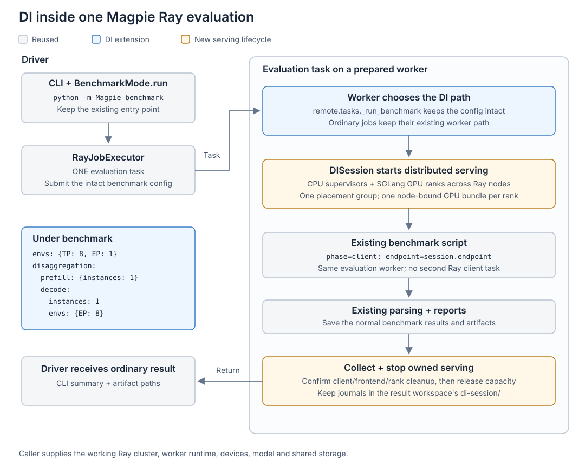

# Native Ray DI

DI follows the [existing Ray benchmark contract](ray.md): provide a working,
reachable Ray cluster with GPUs, the serving runtime, model access and shared
storage already configured. Magpie does not provision the cluster.

## One-time cluster setup

The cluster owner prepares the runtime once; evaluation users then submit YAML.
An existing DI-ready Ray cluster needs no Kubernetes changes. For a new KubeRay
cluster, use [the two-worker MI355X example](../../examples/kubernetes/ray-di-mi355x.yaml)
as a site-specific starting point, not a ready-to-apply deployment.

| Cluster owner, once | Evaluation user, per run |
|---|---|
| Build/load the serving image; configure GPU/RDMA access, model mounts and shared storage | Pick a model/workload and add `benchmark.disaggregation` |
| Start compatible Ray head/workers and qualify one routed DI run | Submit the ordinary Magpie benchmark command |
| Update workers when the image changes | Read the usual results and DI logs |

The [DI image recipe](../../docker/di-ray/Dockerfile) starts from the pinned
SGLang 0.5.18 / ROCm 7.2 MI35X image and adds Ray 2.55.1, Mooncake ROCm 0.3.14,
router 0.3.2, lm-eval 0.4.12 API dependencies and this checkout of Magpie. Its serving/Ray interpreter is
`/opt/venv/bin/python` (Python 3.10). InferenceX is pinned to
`408c015be4b22d14c69518643609669405507077` at `/opt/InferenceX`, with its
separate Python 3.12.12 client at `/opt/magpie-client/bin/python`.
`MAGPIE_BENCHMARK_PYTHON` selects that client automatically.

Build from the repository root on a suitable builder:

```sh
docker build --platform linux/amd64 -f docker/di-ray/Dockerfile \
  -t magpie-di-ray:local .
```

Load that image onto **every assigned Kubernetes node**, or push it to a registry
you use for this cluster. Replace `USER_PREPARED_DI_IMAGE` in the example's
`headGroupSpec` image field; the worker field shares that value. Use an immutable
digest for a registry image, or a unique locally loaded tag with
`imagePullPolicy: IfNotPresent`. Use the same image for head and workers; any
external driver must also match Ray 2.55.1 and Python 3.10. No image is built or
published when an evaluation is submitted. Direct dependencies are pinned;
transitive dependencies resolve at build time, so retain the built image digest.

Before starting the cluster, the cluster owner supplies:

- Two compatible eight-GPU nodes for TP8 prefill + TP8 decode. The example keeps
  workers on distinct hosts; reserve them for these runs.
- Working AMD GPU and site RDMA device plugins. The example's
  `rdma/rdma_shared_device_a` is a placeholder resource name, not a standard.
  Plugins must expose GPU devices (`/dev/kfd` and render devices) and required
  RDMA devices (`/dev/infiniband`). Supply the host driver, fabric libraries and
  route/NIC configuration compatible with the image; the image cannot provide
  a missing host driver or site provider.
- Worker-to-worker connectivity for Ray and serving/transfer traffic. The
  example uses host networking and fixed Ray ports; permit them only on the
  trusted cluster network. Avoid conflicting services on these hosts.
- An adequate locked-memory limit and `IPC_LOCK` for the transfer runtime.
  Configure the container runtime's memlock policy; the capability alone does
  not raise its limit. No blanket privileged pod or whole-device mount is used.
- A pre-existing shared RWX volume mounted at `/shared` on head/workers, with
  model/tokenizer files and writable results/cache directories. Replace
  `USER_SHARED_RWX_PVC`, namespace and resource sizes for the site. Mount any
  private-model credentials through the site's existing secret mechanism.

Follow the [KubeRay configuration](https://docs.ray.io/en/latest/cluster/kubernetes/user-guides/config.html),
[GPU setup](https://docs.ray.io/en/latest/cluster/kubernetes/user-guides/gpu.html)
and [Mooncake ROCm requirements](https://github.com/kvcache-ai/Mooncake/blob/main/docs/source/getting_started/quick-start.md#other-platforms)
when adapting the example. Keep the Ray head service private.

Qualify the prepared cluster before sharing it:

1. On every worker, check imports with the serving interpreter and confirm
   actual GPU/RDMA devices, provider availability, shared paths and memlock.
   Check the separate client's InferenceX import from `/opt/InferenceX`.
2. Confirm Ray reports both distinct workers with eight GPUs each and enough
   spare CPU for the evaluation task. Ray resource counts alone do not prove
   device or transfer access.
3. Run a small DI benchmark with accuracy disabled. Check role/router readiness,
   a routed completion, real transfer evidence and normal output artifacts.
4. Enable the intended accuracy task and run the target workload matrix. Check
   serving/client cleanup and return of all Ray reservations after success and
   cancellation. Qualify performance and accuracy on the actual model/fabric.

The recipe and example do not establish GPU, RDMA or accuracy qualification.
For a local smoke check, inside the candidate image:

```sh
/opt/venv/bin/python -c 'import ray, torch, mooncake.engine, sglang_router.launch_router; from Magpie.di import DISession; print(ray.__version__, torch.__version__)'
cd /opt/InferenceX
/opt/magpie-client/bin/python -c 'from infx.bench_serving import benchmark_serving'
```

## Evaluation flow

The entry point remains `python -m Magpie benchmark`.
`benchmark.disaggregation`, beside `benchmark.envs`, opts into a serving session
on the evaluation worker. The driver uses the ordinary
`BenchmarkMode.run()` → `RayJobExecutor` path to submit **one evaluation task**,
with the DI configuration intact. The worker starts P/D/router, then runs the
existing benchmark script in `client` phase against the verified endpoint.
That client runs on the same worker; it does not submit another Ray task.



| Step | Ordinary Ray benchmark | DI Ray benchmark |
|---|---|---|
| Driver | Submit one evaluation task | Same |
| Worker serving | Existing engine launch | Start prefill, decode and router through `DISession` |
| Measurement | Existing benchmark script | Same script, `phase=client`, explicit endpoint |
| Finish | Parse/save results and cleanup | Same result format; stop owned DI serving before returning |

`Magpie/di/native_config.py` validates the topology; `native_ray.py` owns serving
and cleanup, including failure and cooperative cancellation.
CPU-only supervisors start SGLang HTTP frontends; SGLang's `RayEngine` owns the
GPU rank actors through `--use-ray`. A private, version-pinned
`Magpie/di/sglang_ray.py` adapter passes the session's existing placement group
explicitly: stock SGLang HTTP startup does not expose that argument. It does not
monkeypatch SGLang or introduce Ray Serve.

## Configuration

Keep shared settings in `benchmark.envs`. Add `disaggregation` beside `envs`,
then override only the serving settings that differ by role:

```yaml
benchmark:
  framework: sglang
  model: /shared/models/DeepSeek-R1-0528
  precision: fp8
  timeout_seconds: 7200
  run_mode: ray
  ray_config:
    cluster_address: auto
    namespace: magpie-di
    shared_storage_path: /shared/magpie
    install_magpie: false
  inferencex_path: /opt/InferenceX
  benchmark_script: sglang_mi355x.sh
  runner_type: mi355x
  envs:
    TP: 8
    EP: 1
    CONC: 4
    ISL: 1024
    OSL: 100
    RANDOM_RANGE_RATIO: 0.5
    NUM_PROMPTS: 16
    RUN_EVAL: 'false'
    EXTRA_SGLANG_ARGS: --context-length 8192

  # NEW sibling of envs, inside benchmark.
  disaggregation:
    prefill:
      instances: 1
    decode:
      instances: 1
      envs:
        EP: 8
```

Edit [the DI Ray benchmark example](../../examples/benchmarks/benchmark_sglang_dsr1_di_ray.yaml)
for the model and shared paths mounted on your cluster. It uses the image recipe's
`/opt/InferenceX` client path; another prepared runtime may use a different path.

- Prefill inherits TP8/EP1. Decode inherits TP8 and overrides EP to 8. Both use
  PP1 by default and reserve eight GPUs each: sixteen GPUs across two Ray nodes.
- Ports and startup timeout are optional overrides. Magpie fills in server port
  30000, bootstrap port 8998, router port 18000 and a 1800-second startup timeout
  when omitted. These are fixed defaults; a busy port fails the startup check.
- `instances` must be a positive integer. Effective `TP`, `EP` and `PP` default
  to 1 when absent. Each instance needs `TP * PP` GPU ranks; EP uses that rank
  group. The planner derives its node count from available capacity, balancing
  ranks equally across distinct nodes assigned to that instance. It can span
  nodes; different instances do not share nodes. SGLang must support the chosen
  model and TP/EP/PP combination.
- Role `envs` merges over shared serving variables. A role's
  `EXTRA_SGLANG_ARGS` replaces the entire inherited string. Workload/client
  settings such as concurrency, sequence lengths and evaluator options stay in
  `benchmark.envs`; they cannot be overridden per role.
- GPU visibility and Magpie-owned model/topology/port flags cannot be
  overridden; profiling cannot be enabled. Common model flags belong in
  `EXTRA_SGLANG_ARGS`.
- Ray reserves one GPU per rank, `TP * PP` per instance. EP is not multiplied
  into the GPU count. Data parallelism is currently DP1.
- `docker_image` is unsupported in this path. Prepare the runtime when
  creating the Ray workers.
- The model/tokenizer and shared results directory must be accessible to every
  participating worker, with the same shared results path on the driver.
- Keep `HF_TOKEN` and `HUGGING_FACE_HUB_TOKEN` out of DI YAML, including common
  `envs`, role `envs` and `ray_config.env_vars`. Magpie rejects these inline keys
  before creating a DI workspace or ownership journal. Supply model credentials
  through the prepared workers' environment or the site's existing secret
  mechanism; runtime credential forwarding remains supported.
- Coordinated DI profiling and AgentX are not implemented.

## Run and lifecycle API

DI defaults to the existing Magpie SGLang wrapper for the selected runner, rather
than an InferenceX engine-launch script. An explicit `benchmark_script` must honor
`MAGPIE_RUN_PHASE=client` and `BENCHMARK_BASE_URL`; Magpie checks that contract
before reserving serving resources.

`timeout_seconds` gives the benchmark client its budget. The synchronous Ray wait
also allows placement, serving startup and topology-sized cleanup. Cancellation
is requested once, then Magpie waits for cleanup confirmation before reuse.

The serving startup deadline covers supervisor creation, engine/router launch
and routed readiness. Readiness requests use the remaining startup budget.

```sh
python -m Magpie benchmark \
  --benchmark-config examples/benchmarks/benchmark_sglang_dsr1_di_ray.yaml \
  --output-dir results/di-run-001
```

The evaluation worker starts serving, measures the endpoint, saves the usual
results and stops its serving processes. Use a fresh output directory.

The Python API manages serving only. Benchmark execution belongs to the worker's
existing `BenchmarkMode` pipeline; `DISession` does not expose another benchmark
entry point:

```python
from pathlib import Path
import yaml
from Magpie.di import DISession

config = yaml.safe_load(Path("examples/benchmarks/benchmark_sglang_dsr1_di_ray.yaml").read_text())
with DISession(config, "results/session-001") as session:
    print(session.endpoint)
    session.collect()
```

The constructor accepts the complete YAML document or its `benchmark` dictionary.
`replace(new_config)` collects/stops the generation,
verifies its replacement and attempts restoration if replacement fails after
confirmed cleanup. Changing the worker image requires caller-managed worker
replacement, outside this session API.
The worker uses `client_run()` to journal client ownership around its existing
script invocation; that context does not launch or schedule a client.

## Ownership and recovery

One detached placement group reserves every engine rank in a node-bound,
one-GPU bundle. SGLang's rank actors consume those same bundles; there is no
second GPU reservation. CPU-only supervisors own the frontends and their
process groups, with the router on the first prefill frontend's node. The
evaluation task runs the client on the worker selected by the normal executor.
Leave CPU capacity for that task and the supervisors.

Use workers reserved for the DI run. Ordinary Magpie Ray benchmarks can launch
local engines outside Ray's GPU reservations; do not run them on participating
DI workers concurrently.

`native-session.json` records ownership, commands, logs and generation history.
Readiness verifies role/model/parallelism, router health and a routed completion.

Cleanup stops owned clients/frontends and verifies SGLang rank-actor termination
before releasing supervisors and placement resources. Unconfirmed client cleanup or missing launchers blocks
normal reuse. Detached actors intentionally survive driver loss.

```python
from Magpie.di import DISession

session = DISession.load("/shared/path/to/result-workspace/di-session")
print(session.inspect())
session.collect()
session.stop()
```

`DISession.load(state_dir)` permits inspection, collection and cleanup only. It
does not reacquire lost ownership or start new serving. Loss of the Ray cluster
or worker pods requires operator reconciliation; Magpie does not replace
Kubernetes scheduling or recovery policy.
A launcher can also be created before its identity has been saved—for example,
if the creation reply or identity RPC is lost. That prelaunch identity gap requires
manual operator reconciliation; `load()` does not automatically adopt the actor
or establish ownership that the journal never confirmed.
Use the actual shared worker result workspace recorded for the evaluation;
its `di-session/` directory contains the ownership journals and serving logs.

## Limits

The scope is SGLang's pinned Ray HTTP runtime with DP1. Multiple prefill/decode
instances and multi-node `TP * PP` rank layouts are supported by orchestration;
each model, parallelism combination and fabric still needs GPU qualification.
This is not a claim of complete framework or non-DI feature parity.

The existing client workload matrix, result pipeline and endpoint evaluator are
reused. Accuracy tasks require endpoint API support, including prompt logprobs
for likelihood tasks. Coordinated DI profiling remains blocked and needs
separate work. AgentX is also unsupported by the existing non-DI Ray benchmark
path; caller adapters for Crystal/Hyperloom are outside this change.

CPU fixtures can check orchestration, routing and the client/result contract.
They cannot qualify real SGLang GPU ranks, model accuracy, RDMA transfer or
performance. Validate those on the target cluster before production rollout.

Only `benchmark.disaggregation` opts into the worker's DI path. Non-DI execution,
evaluator setup and package dependencies retain upstream behavior.
